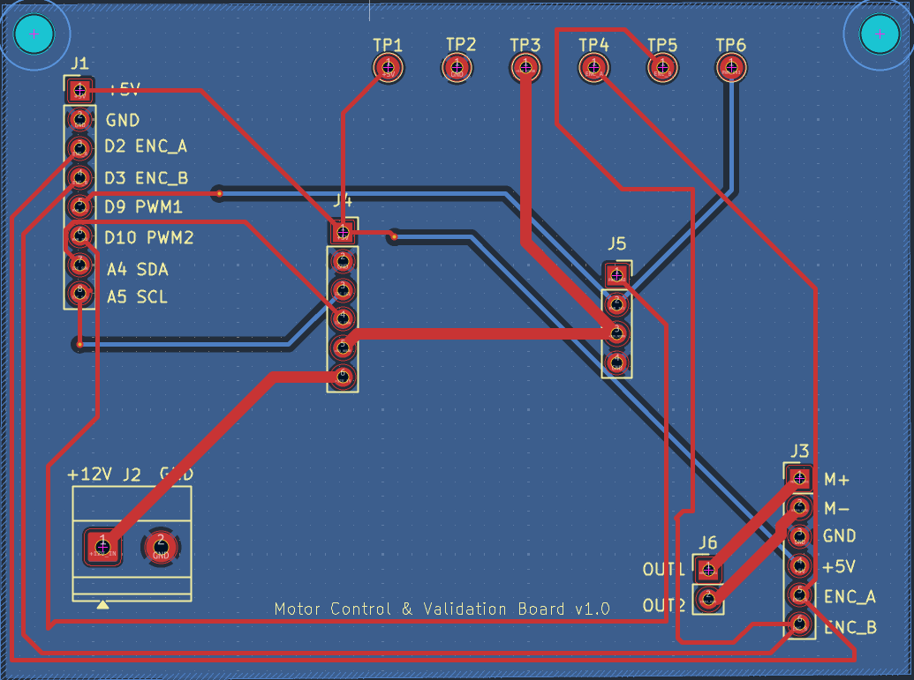
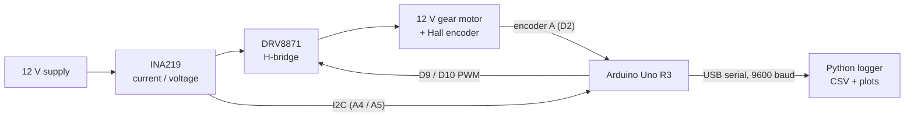
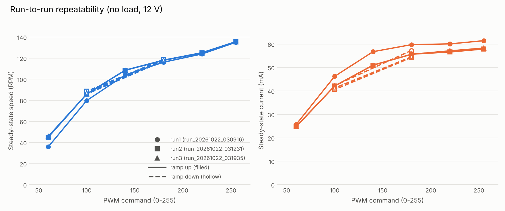
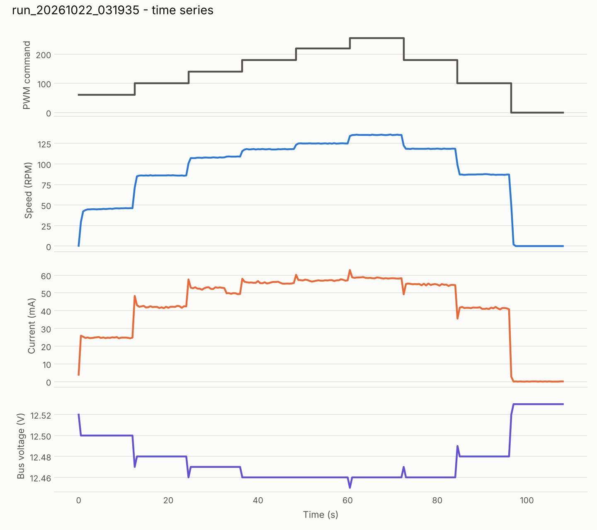
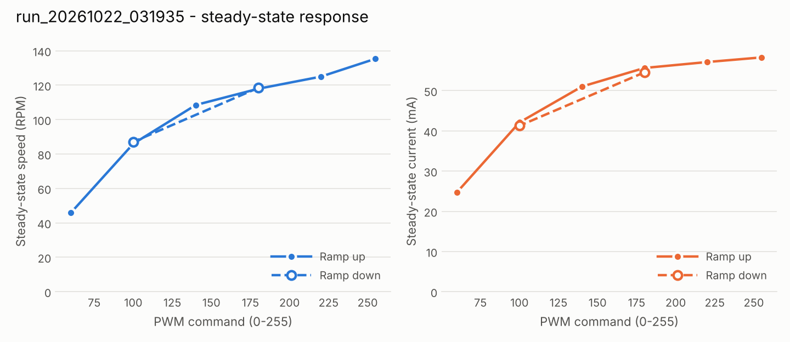
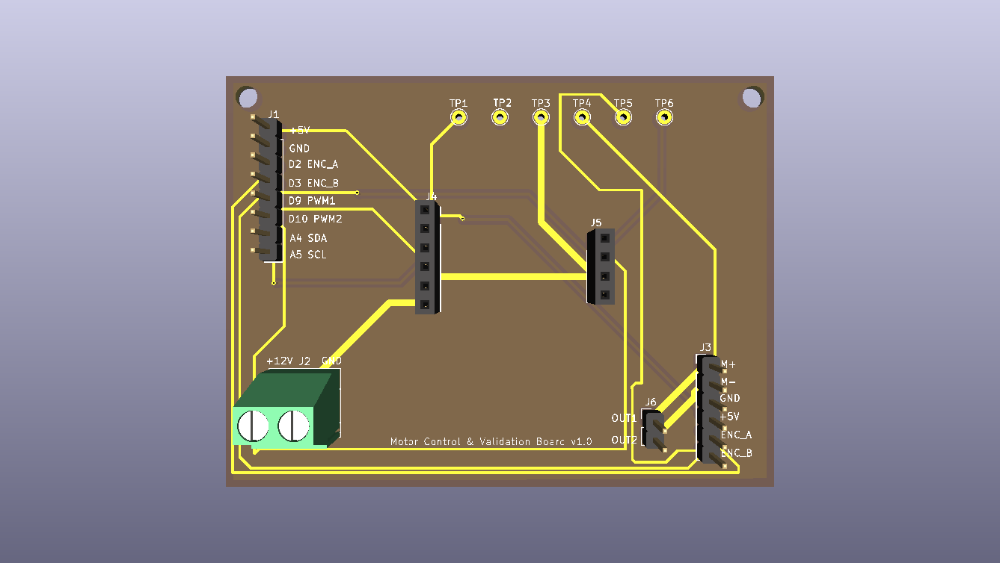

# Custom PCB Motor Control & Validation Platform

A small test platform for a 12 V DC gear motor with a Hall encoder. An Arduino drives the motor through an H-bridge, measures speed and supply current while it runs, and streams the data to a Python logger that saves CSV files and plots. A 2-layer KiCad carrier board was designed to replace the breadboard wiring.



## What it does

- Drives a 12 V gear motor with PWM speed and direction control (DRV8871 H-bridge).
- Measures motor speed from the encoder (interrupt-based pulse counting).
- Measures supply voltage and current with an INA219 sensor, averaging many readings per interval because the PWM chops the supply current.
- Streams `time_ms,pwm,rpm,current_mA,voltage_V` every 500 ms over USB serial.
- Runs an automatic PWM sweep, logs it to CSV, and produces time-series, response and run-to-run repeatability plots.

## System overview



**Hardware used**

| Part | Notes |
|---|---|
| Arduino Uno R3 | Motor control, encoder counting, sensor readout |
| DRV8871 breakout | H-bridge, PWM on IN1 (D9) / IN2 (D10) |
| INA219 breakout | High-side current/voltage sensing, I2C |
| 12 V DC gear motor with Hall encoder (25GA370H type) | 45:1 gearbox, 12 pulses/rev on the encoder, 540 pulses per output revolution |
| 12 V supply | Motor and driver |

## Pinout

| Arduino pin | Signal | Used for |
|---|---|---|
| D9 | PWM_IN1 | DRV8871 IN1 (forward) |
| D10 | PWM_IN2 | DRV8871 IN2 (reverse) |
| D2 | ENC_A | Encoder channel A, rising-edge interrupt |
| D3 | ENC_B | Wired to the board, not read by the current firmware |
| A4 / A5 | SDA / SCL | INA219 |
| 5V / GND | | Encoder and INA219 supply, common ground |

The INA219 sits in series on the high side: supply + goes to VIN+, VIN- goes to the DRV8871 VM pin.

## Repository layout

```
firmware/
  motor_controller/      Final Arduino sketch (control + encoder + INA219)
  i2c_scanner/           Utility to confirm the INA219 is detected
  development/           Earlier steps: motor control only, then + encoder RPM
python_logger/
  motor_logger.py        Serial logger and automatic PWM sweep
  plot_results.py        Plots and steady-state table for one run
  compare_runs.py        Overlay and repeatability table for several runs
hardware/
  kicad/                 KiCad 10 project (schematic + PCB)
  gerbers/               Gerber and drill files (also zipped)
  schematic.pdf          Schematic
  bom.csv                Bill of materials
test_results/            Raw CSVs and steady-state summaries
media/                   Plots and board images
```

## How to run it

**1. Firmware.** In the Arduino IDE install the *Adafruit INA219* library (Library Manager), open `firmware/motor_controller/motor_controller.ino`, select the Uno and upload. If the Serial Monitor reports `Failed to find INA219 chip`, upload `firmware/i2c_scanner` to check the wiring (the INA219 normally shows up at `0x40`). Close the Serial Monitor before using the logger, since only one program can hold the port.

**2. Python setup.** Run all Python commands from the repository root so the outputs land in `test_results/` and `media/`.

```
pip install -r python_logger/requirements.txt
python python_logger/motor_logger.py --list     # find the serial port
```

**3. Run a sweep.** This steps through PWM 60, 100, 140, 180, 220, 255, then back down through 180, 100, 0, holding each level for 12 s (about 108 s total) and writing `test_results/run_<timestamp>.csv`:

```
python python_logger/motor_logger.py --port COM3 --sweep --hold 12
```

`python python_logger/motor_logger.py --simulate` runs the whole pipeline with a synthetic motor and no hardware. Simulated output is only for testing the software and is not real data.

**4. Plot.**

```
python python_logger/plot_results.py test_results/run_20261022_031935.csv
python python_logger/compare_runs.py test_results/run_20261022_030916.csv test_results/run_20261022_031231.csv test_results/run_20261022_031935.csv
```

## Results

All results are **no-load** (the motor shaft was not loaded) on a 12 V supply, from three full sweeps on 2026-10-22. Each value is the mean over the second half of a 12 s hold, so the settling transient is excluded.



Steady-state speed on the ramp up, three runs:

| PWM | Run 1 (cold start) | Run 2 | Run 3 | Runs 2-3 differ by |
|---|---|---|---|---|
| 60 | 35.96 RPM | 45.03 | 45.80 | 1.7 % |
| 100 | 79.81 | 86.03 | 85.97 | 0.1 % |
| 140 | 104.12 | 108.62 | 108.49 | 0.1 % |
| 180 | 116.17 | 118.13 | 117.92 | 0.2 % |
| 220 | 124.00 | 125.22 | 124.95 | 0.2 % |
| 255 | 135.02 | 135.64 | 135.34 | 0.2 % |

Supply current at full PWM was about 58 mA (roughly 0.72 W electrical input) in the two warm runs and 61 mA in the cold run, and about 0.05 mA with the motor stopped. Bus voltage stayed between 12.45 V and 12.53 V in all three runs.

Time series of the third run:



Steady-state response of the third run (ramp up solid, ramp down dashed):



Raw data and per-run summaries are in [`test_results/`](test_results/), and the three-run comparison is in [`media/repeatability_summary.csv`](media/repeatability_summary.csv).

### Notes and limitations

- **Run 1 is a cold start.** The gearbox was cold, so at the same PWM it ran slower and drew roughly 5-11 % more current than runs 2 and 3. Runs 2 and 3 agree to within 0.3 % at PWM 100-255. The speed also creeps up slightly during a hold, which is consistent with warm-up.
- **The up/down difference is not cleanly separable from warm-up.** At PWM 100 the ramp-down speed is higher than the ramp-up speed (2.9 % in run 2), but because the motor is warmer by then this is not evidence of true hysteresis.
- **Low PWM is the least repeatable region.** Near PWM 60 the motor is close to the point where friction dominates, so run-to-run differences are largest there.
- **Speed resolution is about 0.22 RPM.** One encoder pulse in a 500 ms window is 1/540 of a revolution.
- **No load, no torque measurement.** Only electrical input power was measured, so this data does not give efficiency or torque.
- **Direction is not sensed.** Only encoder channel A is counted.
- **Discarded runs.** Earlier attempts were excluded and not included: two runs where the logger saved no data or the supply connection dropped out, and one run taken with a loose 12 V connection (bus voltage sagging to 11.6 V, with a dip to 10 V). The connection was fixed before the three runs above.

## PCB

A 80 x 60 mm, 2-layer carrier board (KiCad 10.0.6) that connects the Arduino, the DRV8871 and INA219 modules, the power input and the motor/encoder connector through headers instead of breadboard wires.



- Signal traces on the top layer, with vias to the bottom layer where needed, and a ground zone on the bottom layer.
- Two net classes: default signals (0.4 mm tracks) and a power class (1.0 mm tracks) for the 12 V and motor-output nets.
- Six through-hole test points: +5V, GND, +12V_MOTOR, ENC_A, ENC_B, PWM_IN1.
- Two M3 mounting holes.
- Design rule check was clean (no violations, warnings or unconnected items) at the time of the Gerber export.

Files: [`hardware/schematic.pdf`](hardware/schematic.pdf), [`hardware/bom.csv`](hardware/bom.csv), [`hardware/gerbers/`](hardware/gerbers/), [`hardware/kicad/`](hardware/kicad/).

### Status

The board is **designed and passes DRC, but it has not been fabricated or tested**. All measurements above were taken on a breadboard prototype with the same circuit. Before ordering the board, check that the socket pin order on J4 (INA219) and J5 (DRV8871) matches the actual breakout modules in use, since module pin orders vary between vendors.

## License

MIT, see [LICENSE](LICENSE).
